# douyin-simple-comic-workflow 1.1.0-rc.1

把中文文案制作成静态抖音漫画组图，内含 Skill `1.1.0-fast-semantic`。新日常任务默认使用 **FAST**：先完成整组分镜、文字设计和实际字体试排，再冻结规划、整页生图、逐页查看画面并本地排字。需要精确画格、严格气泡位置或完整 SB 验收时，使用保留的 **STRICT** 流程。

## 使用方式

安装本包后，可以直接提出：

> 使用 $douyin-simple-comic-workflow 的新版 FAST 模式，把下面的故事制作成 3:4 竖版漫画。新建独立项目，保留历史项目和图片。页数根据故事合理安排，不为凑页数增加情节。沿用项目已确认的画风，人物外观保持一致。根据每页的语境、动作和情绪，从原有 SB 库选择合适分镜，并设计旁白、对白或其他文字形式。先完成整组规划与文字试排，再逐页生成、查看画面并本地排字，最终每页交付一张选定成品。请实际完成漫画，不只输出提示词。故事：……

恢复时给出项目目录并要求“继续已有 FAST 项目”；只改文字时要求“沿用现有底图，单独调整本页字幕”。已有项目按原模式恢复，旧 STRICT 项目不会自动迁移。

精确生产可以明确提出：

> 使用 STRICT 模式制作静态漫画组图，要求精确执行选中的 SB 画格和文字容器，完成一页真实样稿后按严格队列继续，保留模板匹配和交付验收记录。

也可以只要求拆页、分镜或提示词；提示词输出不代表图片生成完成。画风、情绪强度和改编范围由当前任务决定，不把某篇故事的人物、关系或措辞固定为所有项目的规则。工作流不制作视频，也不自动发布。

## FAST 与 STRICT

| 项目 | FAST：新日常任务默认 | STRICT：精确生产 |
| --- | --- | --- |
| 分镜 | 按语境选择原有 68 套 SB，以最少充分画格表达动作和情绪 | 按原生模板执行精确画格、阅读顺序和文字容器 |
| 生图 | 一页一次整页请求，一页一个最终候选 | 生成独立画格素材，再确定性组版 |
| 规划 | 整组规划、字体试排后冻结；恢复读取已有状态 | 保留原有完整预检、冻结与严格验收 |
| 重试 | 只重试失败页，每页最多 2 次尝试 | 保留原严格队列的调度、恢复与尝试上限 |
| 看图 | 每页保存后实际检查人物、情节与分镜，检查记录绑定当前底图后才继续 | 保留真实样稿放行、实图绑定和生产验收 |
| 文字 | 依实际画格、人物和保护区域本地设计旁白、对白、心声等，可单独重排 | 按模板和实图绑定执行原文字能力 |
| 验收边界 | SB 为构图参考，近似改编须记录，不声称严格几何通过 | 保留 SB 严格匹配、明确适配及其各自的结果 |

具体规则以 [FAST 工作流](skills/douyin-simple-comic-workflow/references/fast-workflow.md) 和 [STRICT 工作流](skills/douyin-simple-comic-workflow/references/strict-workflow.md) 为准。图像生产仅使用运行环境提供的 Codex 内置 `image_gen`；本地脚本负责保存规划、调度、复制校验、文字合成和检查，不内置图像服务或账号凭据。内置工具不可用时保存状态并报告，不自动切换到外部 API 或 CLI 生图。

## 新版 FAST 的工作方式

- **按叙事选分镜**：每页记录叙事功能、画格数量的理由和每格的主要动作或情绪，从原有 68 套 SB 中选择。叙事适配优先，相近候选才考虑前后变化；不按句子数机械分格，不设置模板种类配额或固定轮换。全组统一或连续三页相同 SB 时，需记录具体叙事理由及兼容替代。复杂 SB 的近似改编需明确说明。
- **先试排，再冻结**：整组一次保存原文事实、人物卡、画风、分镜、文字归属和逐页提示词。生图前使用实际字体、字号和目标尺寸检查容量；不静默删字或缩字。冻结后恢复不重新分析故事，也不重写提示词。
- **整页生成，逐页检查**：先保存并实际查看第一页，再继续后续页面；之后每页同样检查人物、必要情节和分镜。文件保存成功只证明图片可读且已入库，不能代替看图。人物一致性优先，分镜表达其次，背景丰富度最后。
- **低调用与可恢复**：每页一个最终候选，最多尝试两次，仅失败页可重试。有效成功页跳过；图片复制失败先恢复同一次工具输出，不因保存失败新增生图。人物、画风及验证后的第一页参考跨页复用，不默认增加角色参考图生成任务；当前页 SB 决定构图，不照搬参考页的分镜。
- **文字跟随实际画格**：无字底图生成后，依据实际画格、说话者与留白落实文字，避开脸、手及关键物件。旁白、对白、心声、喊话和说明分别使用相应形式，保留原文语义和人物归属；气泡尾巴仅绑定已确认的同格人物。字体、线条和配色保持整组统一，形式随语境变化。
- **字幕独立修订**：局部调整文字区域、字号或同语义容器，另存修订和选定成品；不修改底图、冻结输入或生图次数。恢复会沿用已选文字版本，每页只交付一张选定 PNG，过程图和旧版本不混入交付。

FAST 的本地候选评分只帮助筛选 SB；创作者仍需根据原文判断语境与情绪。计划坐标不能冒充实图测量，元数据不能替代实际阅读。保留人工验收状态，不把 FAST 成品标记为 STRICT 通过。真实 Token、额度和费用无法取得时记为 `null`，不推算节省比例。

## 分镜、文字与画布

SB-001 至 SB-068 均保留原始预览、来源说明、结构化 YAML 和索引。FAST 只加载当前选中的 SB，把它作为构图参考；STRICT 根据模板执行画格几何、阅读顺序、具体文字容器和 observed/inferred/unknown 证据，场景模型不能自行增删、合并或拆分严格模板的画格。

默认排字目标为 1080×1440、3:4 竖版。FAST 的模型底图尺寸和布局可能近似，交付须查看实际比例并记录必要的适配；STRICT 的满版适配继续去掉顶部说明区、等比例处理并记录裁切，禁止拉伸。每页交付一个选定最终 PNG，字幕不改写无字底图文件。

原有 68 个模板的字段、绑定、索引和结构诊断记录保留。STRICT 仍有 9 个复杂文字处理限制：**SB-006、SB-040、SB-041、SB-042、SB-043、SB-044、SB-045、SB-046、SB-057** 的相关旋转或多区域配色实例仍会被阻止，不降级成普通长框。模板结构通过不代表所有 68 套模板均已通过真实成图验收，也不承诺与预览像素相同。

STRICT 正式交付通道仍要求每页有来源绑定的文字实例；没有可执行文字区的纯画面页会被阻止，不为通过检查强造气泡。原生 `CANVAS` 文字区仅在模板明确声明并绑定同一实例时执行。FAST 可以按计划输出无需字幕的本地成品，其模式边界独立记录。

STRICT 的原有[生产流程](skills/douyin-simple-comic-workflow/references/production-workflow.md)、[实图运行说明](skills/douyin-simple-comic-workflow/references/actual-image-runtime.md)和[逐页分镜节奏说明](skills/douyin-simple-comic-workflow/references/storyboard-rhythm.md)均保留。普通 FAST 创作或字幕调整不运行严格逐格队列或整库回归。

## 检查与依赖

需要 Python 3.10+，依赖见 `requirements.txt`。正式中文文字必须配置可用中文字体；Windows 默认使用微软雅黑，包内另附马善政字体与 OFL 许可证。字体在规划时以真实文件试排并冻结；结构诊断使用跨平台后备字体，不依赖私人磁盘目录。

FAST 开发回归：

```sh
python -m pip install -r requirements.txt
python -B -m unittest discover -s skills/douyin-simple-comic-workflow/scripts/tests -p 'test_fast*.py' -q
```

需要检查 STRICT 或模板库时，保留原有命令：

```sh
python -B skills/douyin-simple-comic-workflow/scripts/check_executable_templates.py --root skills/douyin-simple-comic-workflow/references/comic-layouts --check-index --output .local-validation/templates.json
python -B skills/douyin-simple-comic-workflow/scripts/verify_template_library.py --root skills/douyin-simple-comic-workflow/references/comic-layouts --output .local-validation/geometry
python -B -m unittest discover -s regression/production -p 'test_*.py' -v
python -B -m unittest discover -s skills/douyin-simple-comic-workflow/scripts/tests -p 'test_storyboard*.py' -v
```

离线测试使用独立临时目录和明确标记的模拟素材，不调用图像模型，不能证明真实速度、费用或漫画质量。新版验证及匿名真实生产观察见 [1.1.0 FAST 验证](validation/fast-1.1.0-rc.1/README.md)。历史记录继续保留：[0.8.1 生产验证](validation/production-0.8.1-rc.1/README.md)、[0.8.2 手机预览移除验证](validation/production-0.8.2-rc.1/README.md)、[0.9.0 逐页分镜验证](validation/production-0.9.0-rc.1/README.md)。

## 包与历史文件

`plugin.json` 与 `.codex-plugin/plugin.json` 均为 `1.1.0-rc.1`，指向 `./skills/`，Skill 版本为 `1.1.0-fast-semantic`。旧 `examples/`、`tests/`、`delivery/` 和历史验证记录保留；原严格回归位于 `regression/production/`，FAST 与分镜回归位于 Skill 的 `scripts/tests/`。仓库仅同步通用能力、文档和验证代码，不上传本次漫画、原文、私人角色素材或本地项目路径。

## 68 个内置漫画分镜预览

这些预览图用于辅助查看和选择分镜。每张图片对应一个 SB 分镜编号；分镜说明仍以对应的 `SB-###.md` 文件为准，预览图不替代正式分镜规则。点击缩略图可以打开仓库内的原图。

### SB-001–SB-016

|  |  |  |  |
| --- | --- | --- | --- |
| <a href="skills/douyin-simple-comic-workflow/references/comic-layouts/preview-images/SB-001.webp"></a><br><sub>SB-001</sub> | <a href="skills/douyin-simple-comic-workflow/references/comic-layouts/preview-images/SB-002.webp"></a><br><sub>SB-002</sub> | <a href="skills/douyin-simple-comic-workflow/references/comic-layouts/preview-images/SB-003.webp"></a><br><sub>SB-003</sub> | <a href="skills/douyin-simple-comic-workflow/references/comic-layouts/preview-images/SB-004.webp"></a><br><sub>SB-004</sub> |
| <a href="skills/douyin-simple-comic-workflow/references/comic-layouts/preview-images/SB-005.webp"></a><br><sub>SB-005</sub> | <a href="skills/douyin-simple-comic-workflow/references/comic-layouts/preview-images/SB-006.webp"></a><br><sub>SB-006</sub> | <a href="skills/douyin-simple-comic-workflow/references/comic-layouts/preview-images/SB-007.webp">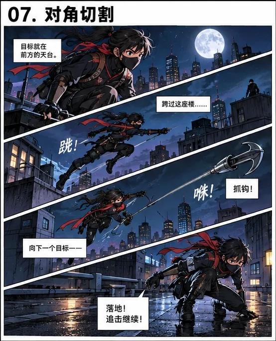</a><br><sub>SB-007</sub> | <a href="skills/douyin-simple-comic-workflow/references/comic-layouts/preview-images/SB-008.webp">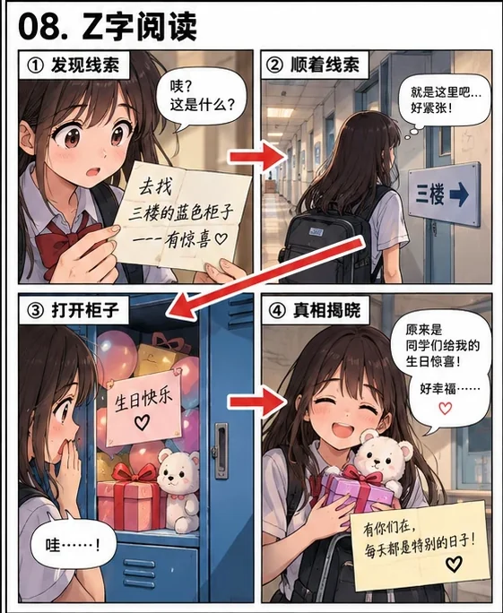</a><br><sub>SB-008</sub> |
| <a href="skills/douyin-simple-comic-workflow/references/comic-layouts/preview-images/SB-009.webp"></a><br><sub>SB-009</sub> | <a href="skills/douyin-simple-comic-workflow/references/comic-layouts/preview-images/SB-010.webp">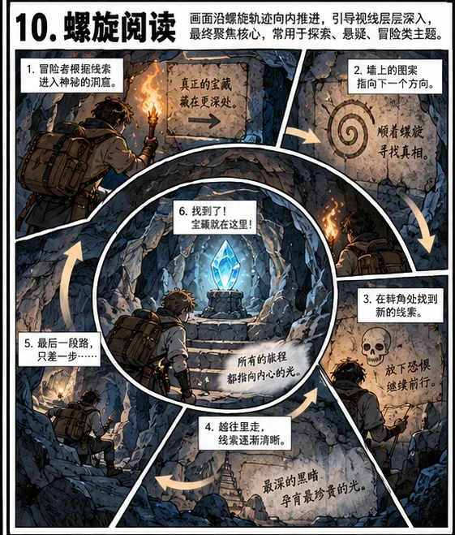</a><br><sub>SB-010</sub> | <a href="skills/douyin-simple-comic-workflow/references/comic-layouts/preview-images/SB-011.webp">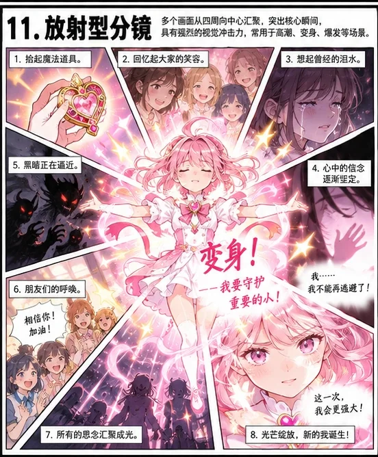</a><br><sub>SB-011</sub> | <a href="skills/douyin-simple-comic-workflow/references/comic-layouts/preview-images/SB-012.webp">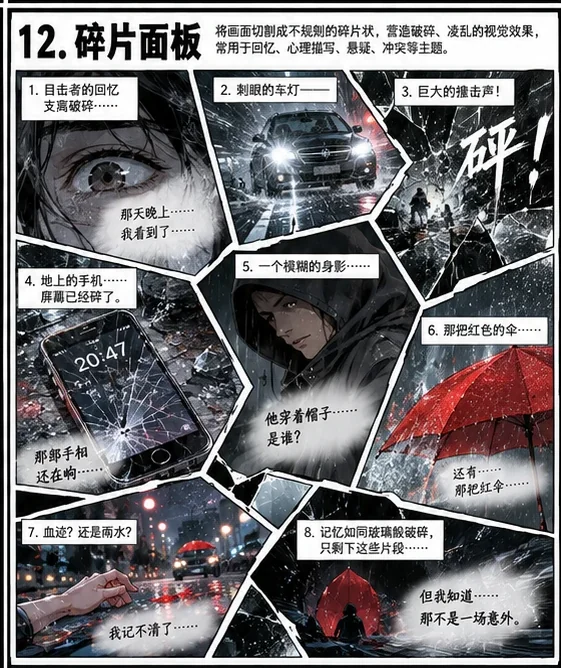</a><br><sub>SB-012</sub> |
| <a href="skills/douyin-simple-comic-workflow/references/comic-layouts/preview-images/SB-013.webp"></a><br><sub>SB-013</sub> | <a href="skills/douyin-simple-comic-workflow/references/comic-layouts/preview-images/SB-014.webp">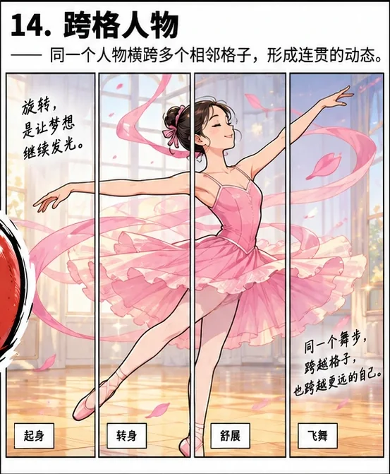</a><br><sub>SB-014</sub> | <a href="skills/douyin-simple-comic-workflow/references/comic-layouts/preview-images/SB-015.webp"></a><br><sub>SB-015</sub> | <a href="skills/douyin-simple-comic-workflow/references/comic-layouts/preview-images/SB-016.webp"></a><br><sub>SB-016</sub> |

### SB-017–SB-032

|  |  |  |  |
| --- | --- | --- | --- |
| <a href="skills/douyin-simple-comic-workflow/references/comic-layouts/preview-images/SB-017.webp">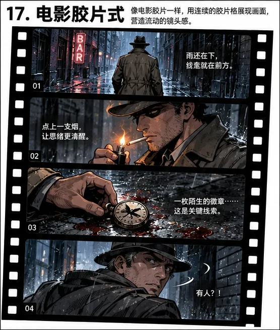</a><br><sub>SB-017</sub> | <a href="skills/douyin-simple-comic-workflow/references/comic-layouts/preview-images/SB-018.webp">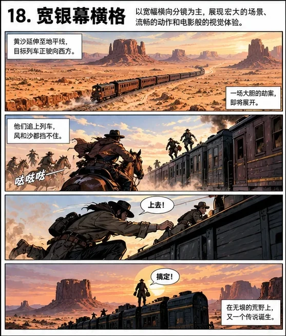</a><br><sub>SB-018</sub> | <a href="skills/douyin-simple-comic-workflow/references/comic-layouts/preview-images/SB-019.webp">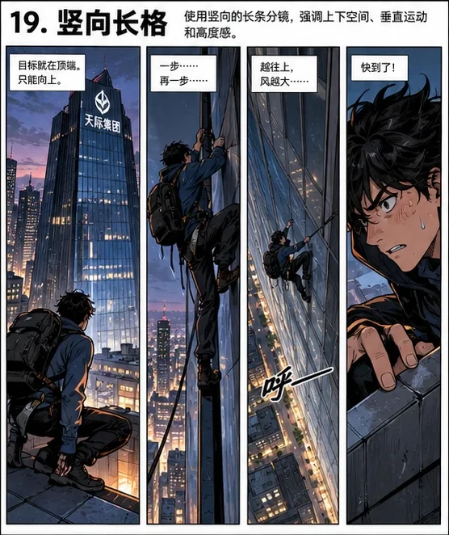</a><br><sub>SB-019</sub> | <a href="skills/douyin-simple-comic-workflow/references/comic-layouts/preview-images/SB-020.webp">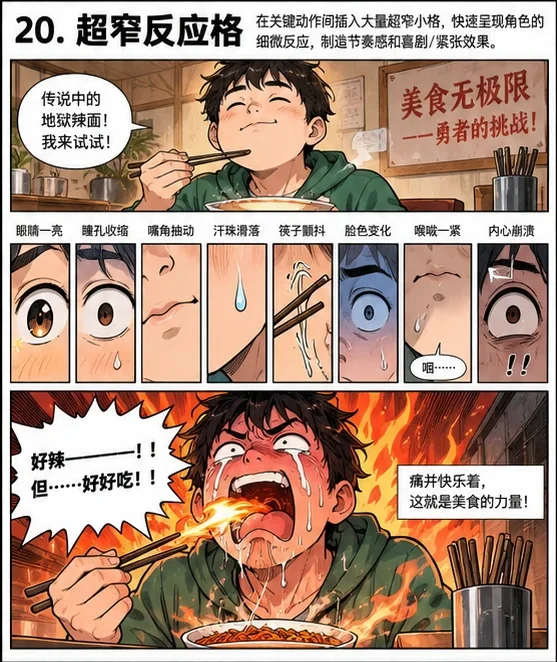</a><br><sub>SB-020</sub> |
| <a href="skills/douyin-simple-comic-workflow/references/comic-layouts/preview-images/SB-021.webp">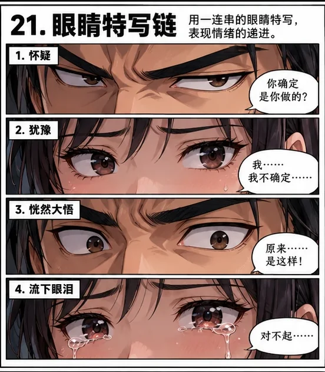</a><br><sub>SB-021</sub> | <a href="skills/douyin-simple-comic-workflow/references/comic-layouts/preview-images/SB-022.webp"></a><br><sub>SB-022</sub> | <a href="skills/douyin-simple-comic-workflow/references/comic-layouts/preview-images/SB-023.webp">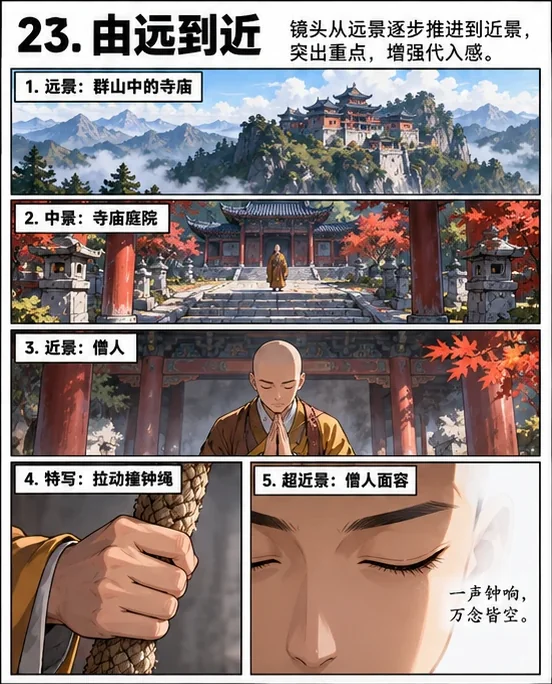</a><br><sub>SB-023</sub> | <a href="skills/douyin-simple-comic-workflow/references/comic-layouts/preview-images/SB-024.webp">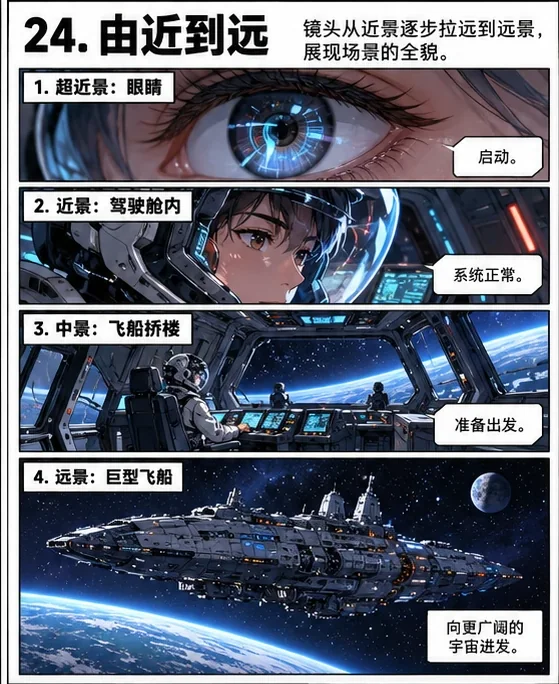</a><br><sub>SB-024</sub> |
| <a href="skills/douyin-simple-comic-workflow/references/comic-layouts/preview-images/SB-025.webp"></a><br><sub>SB-025</sub> | <a href="skills/douyin-simple-comic-workflow/references/comic-layouts/preview-images/SB-026.webp">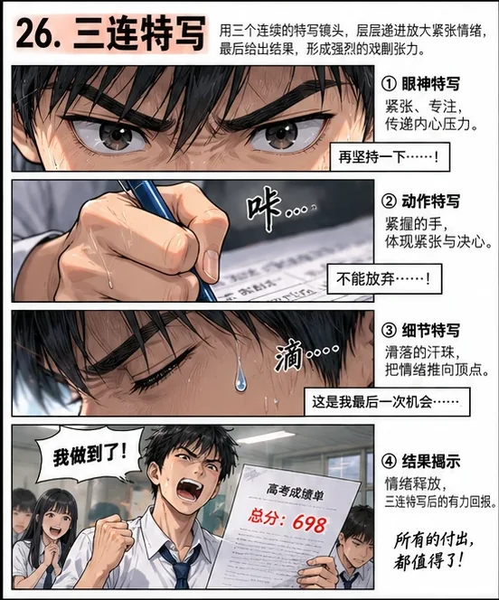</a><br><sub>SB-026</sub> | <a href="skills/douyin-simple-comic-workflow/references/comic-layouts/preview-images/SB-027.webp">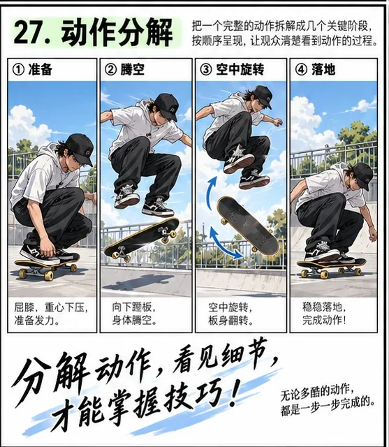</a><br><sub>SB-027</sub> | <a href="skills/douyin-simple-comic-workflow/references/comic-layouts/preview-images/SB-028.webp">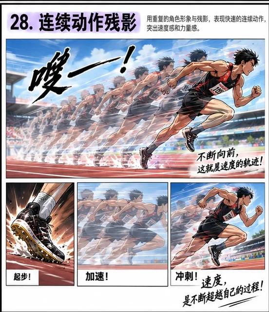</a><br><sub>SB-028</sub> |
| <a href="skills/douyin-simple-comic-workflow/references/comic-layouts/preview-images/SB-029.webp"></a><br><sub>SB-029</sub> | <a href="skills/douyin-simple-comic-workflow/references/comic-layouts/preview-images/SB-030.webp"></a><br><sub>SB-030</sub> | <a href="skills/douyin-simple-comic-workflow/references/comic-layouts/preview-images/SB-031.webp">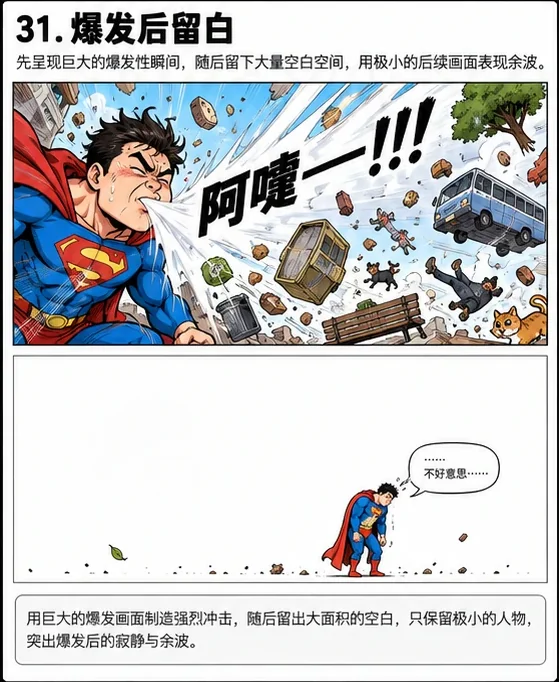</a><br><sub>SB-031</sub> | <a href="skills/douyin-simple-comic-workflow/references/comic-layouts/preview-images/SB-032.webp">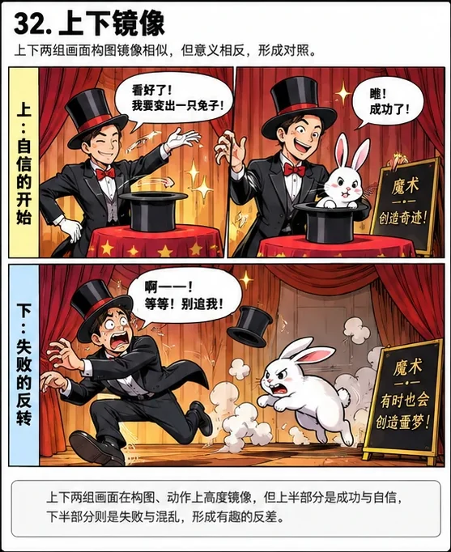</a><br><sub>SB-032</sub> |

### SB-033–SB-048

|  |  |  |  |
| --- | --- | --- | --- |
| <a href="skills/douyin-simple-comic-workflow/references/comic-layouts/preview-images/SB-033.webp"></a><br><sub>SB-033</sub> | <a href="skills/douyin-simple-comic-workflow/references/comic-layouts/preview-images/SB-034.webp"></a><br><sub>SB-034</sub> | <a href="skills/douyin-simple-comic-workflow/references/comic-layouts/preview-images/SB-035.webp"></a><br><sub>SB-035</sub> | <a href="skills/douyin-simple-comic-workflow/references/comic-layouts/preview-images/SB-036.webp">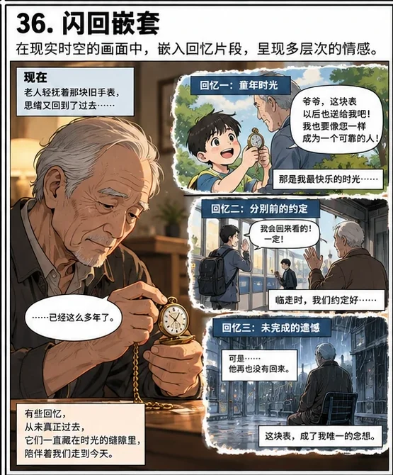</a><br><sub>SB-036</sub> |
| <a href="skills/douyin-simple-comic-workflow/references/comic-layouts/preview-images/SB-037.webp"></a><br><sub>SB-037</sub> | <a href="skills/douyin-simple-comic-workflow/references/comic-layouts/preview-images/SB-038.webp">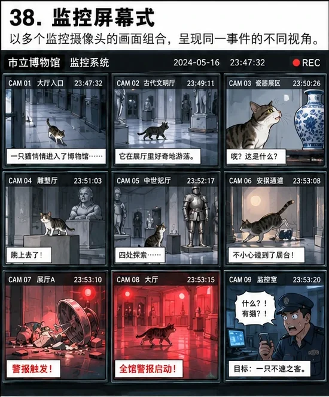</a><br><sub>SB-038</sub> | <a href="skills/douyin-simple-comic-workflow/references/comic-layouts/preview-images/SB-039.webp"></a><br><sub>SB-039</sub> | <a href="skills/douyin-simple-comic-workflow/references/comic-layouts/preview-images/SB-040.webp">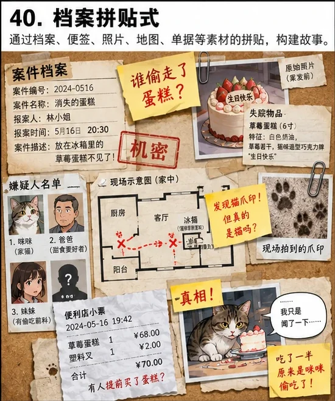</a><br><sub>SB-040</sub> |
| <a href="skills/douyin-simple-comic-workflow/references/comic-layouts/preview-images/SB-041.webp"></a><br><sub>SB-041</sub> | <a href="skills/douyin-simple-comic-workflow/references/comic-layouts/preview-images/SB-042.webp"></a><br><sub>SB-042</sub> | <a href="skills/douyin-simple-comic-workflow/references/comic-layouts/preview-images/SB-043.webp"></a><br><sub>SB-043</sub> | <a href="skills/douyin-simple-comic-workflow/references/comic-layouts/preview-images/SB-044.webp"></a><br><sub>SB-044</sub> |
| <a href="skills/douyin-simple-comic-workflow/references/comic-layouts/preview-images/SB-045.webp"></a><br><sub>SB-045</sub> | <a href="skills/douyin-simple-comic-workflow/references/comic-layouts/preview-images/SB-046.webp"></a><br><sub>SB-046</sub> | <a href="skills/douyin-simple-comic-workflow/references/comic-layouts/preview-images/SB-047.webp"></a><br><sub>SB-047</sub> | <a href="skills/douyin-simple-comic-workflow/references/comic-layouts/preview-images/SB-048.webp">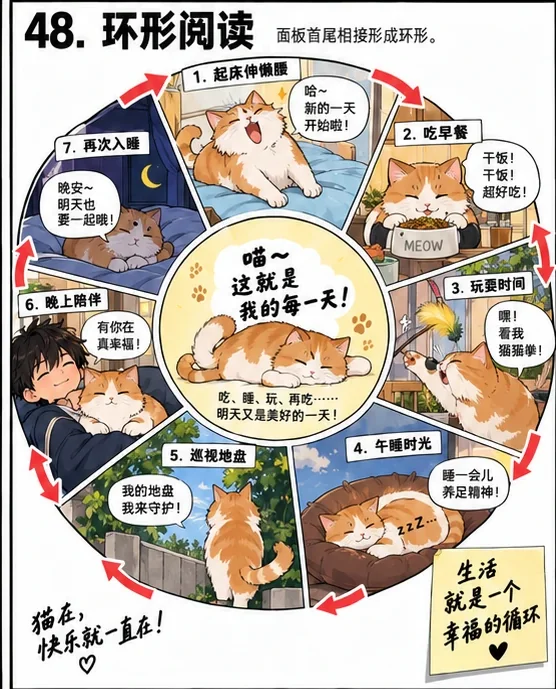</a><br><sub>SB-048</sub> |

### SB-049–SB-064

|  |  |  |  |
| --- | --- | --- | --- |
| <a href="skills/douyin-simple-comic-workflow/references/comic-layouts/preview-images/SB-049.webp">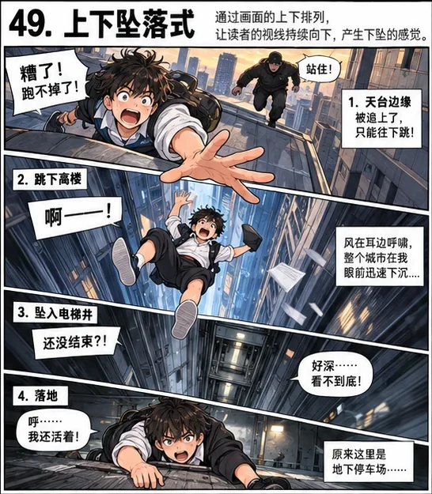</a><br><sub>SB-049</sub> | <a href="skills/douyin-simple-comic-workflow/references/comic-layouts/preview-images/SB-050.webp"></a><br><sub>SB-050</sub> | <a href="skills/douyin-simple-comic-workflow/references/comic-layouts/preview-images/SB-051.webp"></a><br><sub>SB-051</sub> | <a href="skills/douyin-simple-comic-workflow/references/comic-layouts/preview-images/SB-052.webp"></a><br><sub>SB-052</sub> |
| <a href="skills/douyin-simple-comic-workflow/references/comic-layouts/preview-images/SB-053.webp"></a><br><sub>SB-053</sub> | <a href="skills/douyin-simple-comic-workflow/references/comic-layouts/preview-images/SB-054.webp"></a><br><sub>SB-054</sub> | <a href="skills/douyin-simple-comic-workflow/references/comic-layouts/preview-images/SB-055.webp">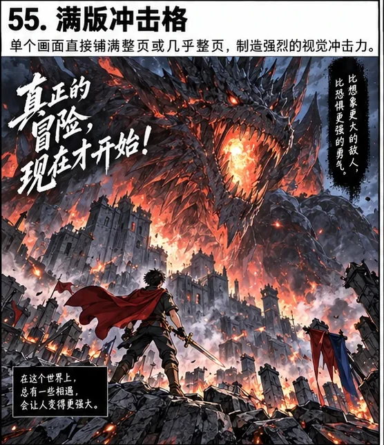</a><br><sub>SB-055</sub> | <a href="skills/douyin-simple-comic-workflow/references/comic-layouts/preview-images/SB-056.webp"></a><br><sub>SB-056</sub> |
| <a href="skills/douyin-simple-comic-workflow/references/comic-layouts/preview-images/SB-057.webp"></a><br><sub>SB-057</sub> | <a href="skills/douyin-simple-comic-workflow/references/comic-layouts/preview-images/SB-058.webp"></a><br><sub>SB-058</sub> | <a href="skills/douyin-simple-comic-workflow/references/comic-layouts/preview-images/SB-059.webp"></a><br><sub>SB-059</sub> | <a href="skills/douyin-simple-comic-workflow/references/comic-layouts/preview-images/SB-060.webp"></a><br><sub>SB-060</sub> |
| <a href="skills/douyin-simple-comic-workflow/references/comic-layouts/preview-images/SB-061.webp"></a><br><sub>SB-061</sub> | <a href="skills/douyin-simple-comic-workflow/references/comic-layouts/preview-images/SB-062.webp">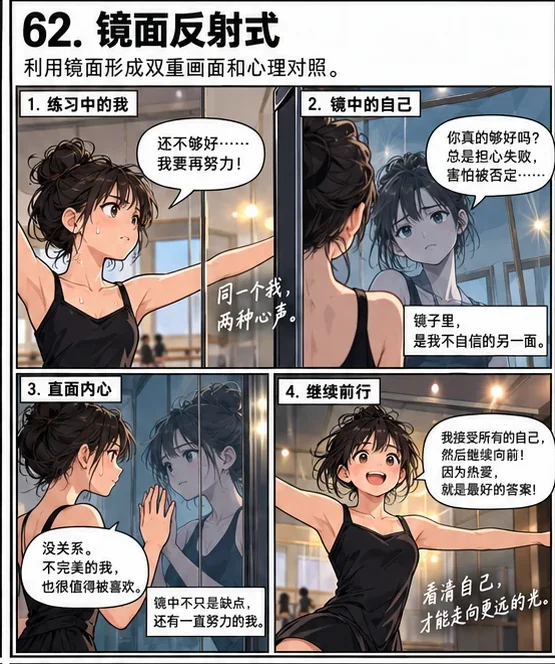</a><br><sub>SB-062</sub> | <a href="skills/douyin-simple-comic-workflow/references/comic-layouts/preview-images/SB-063.webp"></a><br><sub>SB-063</sub> | <a href="skills/douyin-simple-comic-workflow/references/comic-layouts/preview-images/SB-064.webp"></a><br><sub>SB-064</sub> |

### SB-065–SB-068

|  |  |  |  |
| --- | --- | --- | --- |
| <a href="skills/douyin-simple-comic-workflow/references/comic-layouts/preview-images/SB-065.webp"></a><br><sub>SB-065</sub> | <a href="skills/douyin-simple-comic-workflow/references/comic-layouts/preview-images/SB-066.webp"></a><br><sub>SB-066</sub> | <a href="skills/douyin-simple-comic-workflow/references/comic-layouts/preview-images/SB-067.webp"></a><br><sub>SB-067</sub> | <a href="skills/douyin-simple-comic-workflow/references/comic-layouts/preview-images/SB-068.webp">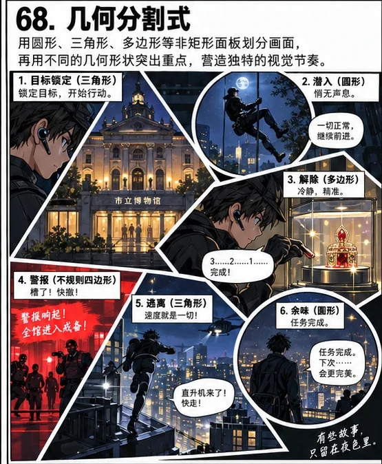</a><br><sub>SB-068</sub> |


